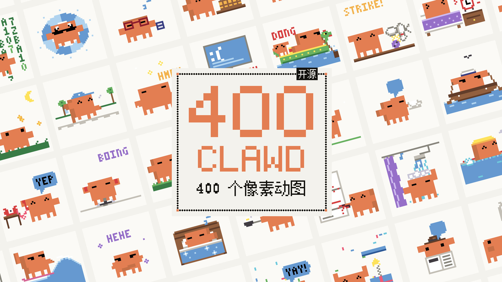

# Clawd 400



400 个 Clawd 像素动图，配上画它们的引擎、两个 Claude Code skill 和两部短片的制作脚本。
动图是透明背景的 480×480 GIF，按 [CC BY 4.0](LICENSE-ART) 授权，署名即可商用；代码按 [MIT](LICENSE) 授权。

400 animated pixel-art GIFs of Clawd, the Claude Code mascot, plus the engine that draws them, two
Claude Code skills, and the scripts for two short films. The GIFs are 480×480 with transparent
backgrounds, under [CC BY 4.0](LICENSE-ART) (commercial use is fine with credit). The code is
[MIT](LICENSE).

**[在线预览 / Gallery](https://khiqwq.github.io/clawd-400/)** ·
[全部下载 / Download all](https://khiqwq.github.io/clawd-400/downloads/clawd-400.zip) ·
[llms.txt](https://khiqwq.github.io/clawd-400/llms.txt) ·
[API](https://khiqwq.github.io/clawd-400/api/index.json)

> 非官方同人作品。Claude、Claude Code 和 Clawd 形象属于 Anthropic，许可证不授予这些商标或形象的权利。详见 [NOTICE.md](NOTICE.md)。
> Unofficial fan art. The Clawd character and the Claude marks belong to Anthropic. See [NOTICE.md](NOTICE.md).

## 预览网站

- **筛选：** 按主题筛选，按中文名、英文名或编号搜索。
- **选择：** 点「选择」进入选择模式，然后：
  - 单击勾选；
  - Shift 点选一段；
  - 全选、反选（只作用于当前筛选结果）、清空；
  - 选好后打包成 ZIP 下载，ZIP 里附带 LICENSE 和 manifest。
- **拖出保存：** 任意动图都能直接拖到桌面、聊天窗口或设计软件里，保存的是原始 GIF 文件。
- **逐帧查看：** 点开一个动图会进入逐帧播放器：
  - 播放和暂停，逐帧前进或后退；
  - 0.25–2 倍速；
  - 洋葱皮和像素网格；
  - 帧条按每帧的真实时长排列；
  - 可导出逐帧 PNG 或帧序列图。
- **背景切换：** 动图底色可切换米白、白、深色和透明格。

The gallery filters by theme and searches titles and numbers. Selection mode supports click,
shift-range, select all, invert and clear (all within the current filter), then downloads a ZIP.
Any GIF drags straight out of the browser as the original file. Clicking a GIF opens a frame
viewer: play and step through frames, change speed, turn on onion skin or a pixel grid, see every
frame with its real duration, and export the frames as PNGs.

## 给 AI 和脚本读 / For AI agents and scripts

网站是纯静态的，所有数据都能直接读取，不需要密钥，也不需要运行 JavaScript。

The site is static; everything is readable without a key or JavaScript:

| URL | 内容 / What |
|---|---|
| `llms.txt` | 给大模型的说明和全部入口 / how an LLM should read the site |
| `api/index.json` | 全部 400 个：编号、slug、中英文名、主题、帧数、时长、各种链接 / the catalog |
| `api/gifs/{nnn}.json` | 单个动图：每帧时长、每帧变化像素数、调色板（色值和名称）、包围盒、sha256、对应的引擎源码行 / one GIF in full |
| `api/frames/{nnn}.txt` | 每一帧都是 40×40 的字符画（一个字符一个像素，附调色板），大模型可以直接"看"动画 / every frame as a 40×40 character grid |
| `sheets/{nnn}.png` | 原始 40×40 尺寸的帧序列图 / all frames side by side at 40×40 |
| `api/openapi.json` | OpenAPI 描述 / OpenAPI description |
| `g/{nnn}-{slug}.html` | 每个动图的静态页，带 JSON-LD / a static page per GIF |

在浏览器里（Playwright、Puppeteer 等）等页面上的 `document.documentElement.dataset.clawdReady === "1"` 就绪后，
可以调用 `window.clawd`：`clawd.help()` 列出全部方法，常用的有 `clawd.list({theme, q})`、
`clawd.frames(n, {format: 'ascii' | 'rgba' | 'dataURL'})`、`clawd.select([...])`、`clawd.selectAll()`、
`clawd.invert()`、`clawd.zip()`。

In a browser, wait for `document.documentElement.dataset.clawdReady === "1"`, then use
`window.clawd`. Run `clawd.help()` to list everything.

## 在 Claude Code 里用这两个 skill / The skills

| Skill | 做什么 / What it does |
|---|---|
| [`clawd-pixel`](skills/clawd-pixel) | 用 Python 引擎画 Clawd 像素动图：40×40 网格放大 12 倍、各种朝向、道具、特效，附风格规则和示例 / draws Clawd GIFs with the engine, plus the style rules and examples |
| [`clawd-halftone`](skills/clawd-halftone) | 画参考视频那种网点背景：正面构图，9 px 网格的圆点，按实测色阶分层 / the videos' dotted halftone backdrops: front-on, a 9-px screen of round dots, measured tone levels |

```text
/plugin marketplace add khiqwq/clawd-400
/plugin install clawd@clawd-400
```

也可以直接把 `skills/clawd-pixel` 和 `skills/clawd-halftone` 复制到 `~/.claude/skills/`。参考视频的截帧和参考 GIF 属于
Anthropic，没有放进仓库；skill 里写了自己的参考素材该放在哪。

Or copy the two folders into `~/.claude/skills/`. The reference frames and GIFs are Anthropic's and
are not included; each skill says where to put your own.

## 引擎 / The engine

```bash
pip install pillow
python generate.py                                # 重新生成全部 gifs/ + manifest.json
python render.py my_scenes.py --out out --sheet   # 渲染自己写的场景
python site/build.py                              # 生成网站到 _site/
python -m http.server 8790 -d _site               # 本地预览 http://localhost:8790
```

| File | What it holds |
|---|---|
| `engine.py` | 40×40 canvas (scaled 12×), palette, Clawd in every view (front, 3/4, strong 3/4, profile, back, tilt), dotted backdrops, GIF writers, registry |
| `props.py` | hats, face gear, held items, effects, 3×5 font and 12px Chinese text |
| `kit.py` | reusable body actions and the `S()` compositor |
| `scenes/*.py` | the scenes, one module per theme (`scenes/__init__.py` sets gallery order) |
| `lint.py` | style check: tinted bodies, retired eye glyphs, anything drawn on Clawd's face |
| `render.py` | a scene file → GIF / WebP / MP4 / PNG frames / contact sheet |
| `pixelize.py`, `study_video.py` | study tools for new reference frames and videos |
| `site/` | the gallery and static API (`build.py`, `src/`) |
| `skills/` | the two Claude Code skills |
| `films/` | the two short films' scripts, see [films/README.md](films/README.md) |

## 短片 / Films

- **《末班车 / The Last Train》**，34.5 秒：午夜的站台，Clawd 带着一盆小芽坐上末班车，天亮时把它种在山顶上。
- **Clawd 400 宣传片**，43 分钟：400 个动图逐个出场，每个都放在对应主题的网点场景里，最后被框起来循环两遍。

制作脚本在 [`films/`](films/README.md)。成片太大，不放进仓库。

## 许可 / Licence

- **代码：** MIT。
- **动图、背景、封面和文档：** CC BY 4.0。
- **署名：** 「Clawd 400 by 风花叶 — CC BY 4.0」。
- **商标：** 两个许可证都不涉及 Anthropic 的商标和形象权利，详见 [NOTICE.md](NOTICE.md)。

Code: MIT. Artwork and docs: CC BY 4.0, credit "Clawd 400 by 风花叶 — CC BY 4.0". Neither licence
covers Anthropic's trademarks or the character; see [NOTICE.md](NOTICE.md).
